# Autós Túra- és Költségmegosztó Tervező

Magyar nyelvű, Java 21 és Apache Maven alapú konzolos alkalmazás több szakaszból álló autós túrák útvonalszakaszainak, becsült menetidejének, üzemanyag- és útdíjköltségeinek megtervezéséhez, valamint rugalmas költségmegosztáshoz.

---

## 1. Projekt összefoglaló és problémafelvetés

### Célfelhasználók és céljuk
Az alkalmazás **baráti társaságok, családok és közös autós túrákat szervező utazók** számára készült, akik egy több eltérő úttípusból álló kirándulás előtt szeretnék előre megbecsülni a várható utazási költségeket és menetidőt, majd a végösszeget igazságosan szétosztani a résztvevők között.

### A megoldott probléma
Egy hosszabb autós út ritkán homogén: az autópályán a nagyobb tempó miatt megnő a fogyasztás és matricadíj merül fel, a hegyi hágókon a szintemelkedés növeli a fogyasztást és a hajtűkanyarok csökkentik az átlagsebességet, míg városi szakaszokon a forgalmi dugók lassítják a haladást és parkolási díjakkal is számolni kell. Emellett gyakori, hogy nem minden utas utazik végig a teljes útvonalon, így az elszámolás módja (egyenlő megosztás vagy megtett kilométer szerinti arányosítás) túránként változhat.

Az **Autós Túra- és Költségmegosztó Tervező** ezeket a szabályokat egységes, objektumorientált modellben kezeli, megőrzi a túraterveket JSON formátumban, és interaktív konzolos felületen teszi lehetővé a túrák tervezését és összehasonlítását.

---

## 2. Előfeltételek (Prerequisites)

- **Java Development Kit (JDK) 21** vagy újabb
- **Apache Maven 3.8** vagy újabb
- Internetkapcsolat az első fordításkor a Maven Central függőségek (`jackson-databind`, `junit-jupiter`) letöltéséhez

Verziók ellenőrzése:

```bash
java -version
mvn -version
```

---

## 3. Fordítás, tesztelés és futtatás (Build, Test, Run)

A projekt tiszta klónozás után közvetlenül fordítható, tesztelhető és futtatható a gyökérkönyvtárból:

### Fordítás
```bash
mvn clean compile
```

### Egységtesztek futtatása (JUnit 5)
```bash
mvn clean test
```

### Alkalmazás indítása (ajánlott)
```bash
mvn exec:java
```

### Csomagolás JAR állományba és indítás
```bash
mvn clean package
java -jar target/roadtrip-planner-1.0.0-SNAPSHOT.jar
```

> **Megjegyzés:** A `maven-jar-plugin` beállítja a `Main-Class: hu.pte.mik.roadtrip.Main` bejegyzést a manifestben. Mivel a `jackson-databind` külső Maven függőség, az alkalmazás teljes funkcionalitású (JSON mentéssel/betöltéssel együtt működő) indításához a `mvn exec:java` parancs használata ajánlott, amely automatikusan összeállítja a teljes futásidejű classpath-t.

### Projektstruktúra és értékelési segédlet
```text
├── docs/
│   └── uml-diagram.md              # UML osztálydiagram (Mermaid) és felhasználói történetek (US-01 – US-06)
├── src/
│   ├── main/java/hu/pte/mik/roadtrip/
│   │   ├── Main.java               # Alkalmazás belépési pont
│   │   ├── domain/                 # TuraTerv, Utas, UtvonalSzakasz + 3 polimorf leszármazott
│   │   ├── exception/              # ErvenytelenAdatException, TulTerheltJarmuException, AdatMentesException
│   │   ├── persistence/            # JsonTuraTarolo (Jackson + try-with-resources)
│   │   ├── service/                # Strategy interfész, stratégiák, TuraKezeloService
│   │   └── ui/                     # KonzolMenu (UTF-8 Scanner alapú magyar konzolos UI)
│   └── test/java/hu/pte/mik/roadtrip/
│       ├── domain/                 # UtvonalSzakaszTest, TuraTervTest
│       ├── persistence/            # JsonTuraTaroloTest (@TempDir)
│       └── service/                # KoltsegOsztasiStrategiaTest
├── LICENSE                         # MIT licenc
├── pom.xml                         # Maven 21 build, Jackson, JUnit 5, exec-maven-plugin, maven-jar-plugin
└── README.md
```

**Gyors kiértékelési lépések oktatók számára:**
1. Futtassa a `mvn clean test` parancsot (15 JUnit 5 teszt ellenőrzi a polimorfizmust, a kivételkezelést, a Strategy mintát és a JSON perzisztenciát).
2. Indítsa el az alkalmazást a `mvn exec:java` paranccsal: ha még nem létezik `turak.json`, a program automatikusan betölt egy **Erdélyi körút** mintatúrát mindhárom szakasztípussal és 3 utassal.
3. Próbálja ki a `2`-es menüpontban a szakaszok rendezését (távolság / költség / menetidő), a `4`-es menüpontban a férőhely-ellenőrzést, az `5`-ös menüpontban a költségmegosztási stratégia futásidejű váltását, majd a `6`-os menüponttal mentse el az adatokat a `turak.json` fájlba és indítsa újra a programot az adatmegőrzés ellenőrzéséhez.

---

## 4. Minta használat (Sample usage)

Első indításkor (amikor a `turak.json` még nem létezik) a program automatikusan létrehozza az **Erdélyi körút** mintatúrát:

```text
=========================================================
      Autós Túra- és Költségmegosztó Tervező
=========================================================
A(z) 'turak.json' még nem létezik. Mintatúra létrehozása az azonnali kipróbáláshoz...

---------------------------------------------------------
Aktív túra: Erdélyi körút (Skoda Octavia Combi) | Összes túra: 1 db
Aktív költségosztási stratégia: Egyenlő elosztás
---------------------------------------------------------
1) Új túraterv létrehozása
2) Aktív túra kiválasztása és részleteinek megtekintése
3) Útvonalszakasz hozzáadása az aktív túrához
4) Utas hozzáadása az aktív túrához
5) Költségmegosztási stratégia váltása és elszámolás
6) Adatok mentése (turak.json) és kilépés
Válasszon menüpontot (1-6): 2
```

Az aktív túra részleteinek megtekintése távolság szerinti rendezéssel:

```text
=========================================================
Túra neve:       Erdélyi körút
Jármű:           Skoda Octavia Combi (férőhelyek: 3/5 fő, szabad: 2 fő)
Fogyasztás / ár: 6,8 l/100 km | 620 Ft/liter
Össztávolság:    343,0 km
Összköltség:     26498 Ft
Becsült menetidő: 5 óra 59 perc (5,98 óra)

Útvonalszakaszok:
  1. [Városi] Kolozsvár belvárosi áthaladás - 18,0 km | Költség: 3259 Ft | Menetidő: 0,75 óra (parkolás: 2500 Ft, dugó faktor: 1,45x)
  2. [Hegyi hágó] Transzfogarasi út (Bâlea-tó) - 90,0 km | Költség: 5445 Ft | Menetidő: 3,36 óra (szintemelkedés: 1450 m, hajtűkanyarok: 28 db)
  3. [Autópálya] M5 - M43 autópálya (Budapest - Nagylak) - 235,0 km | Költség: 17794 Ft | Menetidő: 1,88 óra (matrica: 6400 Ft, átlagsebesség: 125 km/h)

Utasok:
  1. Kovács Péter (343,0 km)
  2. Nagy Anna (343,0 km)
  3. Szabó Gábor (180,0 km)
=========================================================
```

Költségmegosztási stratégia váltása az `5`-ös menüpontban (**Távolságarányos elosztás** választásával):

```text
--- Költségmegosztási stratégia és elszámolás ---
Jelenlegi stratégia: Egyenlő elosztás
1) Egyenlő elosztás (minden utas azonos összeget fizet)
2) Távolságarányos elosztás (megtett km arányában)
Válasszon stratégiát (1-2): 2

Aktív stratégia beállítva: Távolságarányos elosztás
Túra teljes költsége: 26498 Ft
Utasonkénti fizetendő összegek:
  - Kovács Péter         (343,0 km):      10495 Ft
  - Nagy Anna            (343,0 km):      10495 Ft
  - Szabó Gábor          (180,0 km):       5508 Ft
```

---

## 5. Megvalósított OOP követelmények

| Követelmény | Megvalósítás a forráskódban |
| :--- | :--- |
| **Kapszulázás (Encapsulation)** | Minden domain osztály (`Utas`, `UtvonalSzakasz`, `AutopalyaSzakasz`, `HegyiHagoSzakasz`, `VarosiSzakasz`, `TuraTerv`) kizárólag `private` mezőket használ, nincs publikus módosítható mező. A konstruktorok és validált setterek (`Utas.setMegtettKm`) érvényes objektumállapotot garantálnak; a `TuraTerv.getSzakaszok()` és `TuraTerv.getUtasok()` nem módosítható listanézetet (`Collections.unmodifiableList`) ad vissza. |
| **Absztrakció (Abstraction)** | Az absztrakt `UtvonalSzakasz` osztály és a `KoltsegOsztasiStrategia` interfész stabil szerződést definiál a szakaszok költség-/menetidő-számítására (`szamoltKoltseg()`, `becsultMenetidoOra()`) és az elszámolási politikákra (`elosztKoltseg(TuraTerv)`). |
| **Öröklődés és futásidejű polimorfizmus** | Az `UtvonalSzakasz` absztrakt ősosztályból három konkrét osztály származik: `AutopalyaSzakasz` (+15% fogyasztási felár, matricadíj, átlagsebesség), `HegyiHagoSzakasz` (szintemelkedés alapú fogyasztásnövekedés, hajtűkanyarok és emelkedés miatt csökkentett sebesség, minimum 20 km/h) és `VarosiSzakasz` (parkolási díj, dugó faktorral skálázott menetidő). A `TuraTerv` egységesen `List<UtvonalSzakasz>` kollekción keresztül, futásidőben polimorfikusan hívja a felülírt metódusokat. |
| **Kapcsolatok (Kompozíció és aggregáció)** | A `TuraTerv` kompozícióban tartalmazza saját `UtvonalSzakasz` elemeit (`1` – `0..*`), és aggregációban kezeli a résztvevő `Utas` objektumokat (`1` – `0..*`), a férőhelykorlát szigorú betartásával. |
| **Generikus kollekciók és rendezés** | A rendszer generikus `ArrayList<UtvonalSzakasz>`, `ArrayList<Utas>` és `LinkedHashMap<Utas, Double>` gyűjteményeket használ. Az `UtvonalSzakasz` megvalósítja a `Comparable<UtvonalSzakasz>` interfészt távolság szerinti természetes rendezéshez, míg a `TuraKezeloService` lambda kifejezésekkel rendezi a szakaszokat költség és menetidő szerint. |
| **Validáció és saját kivételek** | Három saját kivételosztály kezeli a hibákat: `ErvenytelenAdatException` (érvénytelen bemeneti/domain adatokra), `TulTerheltJarmuException` (ellenőrzött kivétel a jármű férőhelykorlátjának túllépésekor a `TuraTerv.utasHozzaadasa` metódusban) és `AdatMentesException` (ellenőrzött kivétel I/O és JSON hibákra). A `KonzolMenu` minden bemeneti és üzleti kivételt összeomlás nélkül kezel. |
| **JSON adatmegőrzés (Persistence)** | A `JsonTuraTarolo` Jackson `ObjectMapper` segítségével menti és tölti vissza a `List<TuraTerv>` listát UTF-8 kódolással, `try-with-resources` (`BufferedWriter` / `BufferedReader`) blokkokban. Az `UtvonalSzakasz` `@JsonTypeInfo` és `@JsonSubTypes` annotációkkal biztosítja a polimorf szerializációt és deszerializációt, a számított metódusokon pedig `@JsonIgnore` szerepel. |
| **Egységtesztek (JUnit 5)** | 4 tesztosztályban 15 JUnit 5 teszteset (`UtvonalSzakaszTest`, `TuraTervTest`, `KoltsegOsztasiStrategiaTest`, `JsonTuraTaroloTest`) ellenőrzi a polimorf számításokat, a kivételeket, a stratégiákat és `@TempDir` segítségével a JSON mentést/visszatöltést. |

---

## 6. Választott tervezési minta: Strategy (Stratégia)

### Megoldott tervezési probléma
Egy közös autós túra költségének felosztása többféle szabály szerint történhet (pl. egyenlő elosztás minden utas között, vagy a ténylegesen megtett kilométerek arányában történő felosztás). Ha a számítási logika feltételes elágazásokkal (`if-else` / `switch`) kerülne a `TuraTerv` vagy a `KonzolMenu` osztályba, minden új elszámolási mód bevezetése a meglévő osztályok módosítását kényszerítené ki.

### Résztvevő osztályok és interfészek (`hu.pte.mik.roadtrip.service`)
- **Strategy interfész:** `KoltsegOsztasiStrategia` – definiálja az `elosztKoltseg(TuraTerv tura)` és a `getNev()` szerződést.
- **Konkrét stratégiák:**
  - `EgyenloElosztasStrategia` – a túra teljes költségét egyenlően osztja el a résztvevők között.
  - `TavolsagAranyosStrategia` – az egyes utasok által megtett kilométerek (`megtettKm`) arányában osztja el a végösszeget.
- **Kontextus (Context):** `TuraKezeloService` – tárolja az aktuális `KoltsegOsztasiStrategia` referenciát, lehetővé teszi annak futásidejű cseréjét a `setStrategia(...)` metódussal, és a `koltsegElszamolas(TuraTerv)` híváskor a beállított stratégiára delegálja a számítást.

### Előny a tervezésben
A kliens kód (`TuraKezeloService` és `KonzolMenu`) független marad a konkrét elosztási algoritmusoktól: a stratégia futásidőben szabadon váltható, új elszámolási szabályok a meglévő kód módosítása nélkül (Open/Closed elv) bővíthetők, és minden stratégia önállóan tesztelhető.

---

## 7. UML osztálydiagram

A részletes rendszerterv és a felhasználói történetek (`US-01` – `US-06`) a [docs/uml-diagram.md](docs/uml-diagram.md) dokumentumban, az osztálydiagram szerkeszthető PlantUML forrása pedig a [docs/uml-diagram.puml](docs/uml-diagram.puml) fájlban érhető el.

```mermaid
classDiagram
    direction TB

    class Comparable~UtvonalSzakasz~ {
        <<interface>>
        +compareTo(masik: UtvonalSzakasz) int
    }

    class UtvonalSzakasz {
        <<abstract>>
        -nev: String
        -tavolsagKm: double
        -alapFogyasztas: double
        -uzemanyagAr: double
        #UtvonalSzakasz(nev: String, tavolsagKm: double, alapFogyasztas: double, uzemanyagAr: double)
        #alapUzemanyagKoltseg() double
        +szamoltKoltseg()* double
        +becsultMenetidoOra()* double
        +getSzakaszTipus()* String
        +getNev() String
        +getTavolsagKm() double
        +getAlapFogyasztas() double
        +getUzemanyagAr() double
        +compareTo(masik: UtvonalSzakasz) int
    }

    class AutopalyaSzakasz {
        -FOGYASZTASI_SZORZO: double$
        -matricaDij: double
        -atlagSebesseg: double
        +AutopalyaSzakasz(nev: String, tavolsagKm: double, alapFogyasztas: double, uzemanyagAr: double, matricaDij: double, atlagSebesseg: double)
        +getMatricaDij() double
        +getAtlagSebesseg() double
        +szamoltKoltseg() double
        +becsultMenetidoOra() double
        +getSzakaszTipus() String
    }

    class HegyiHagoSzakasz {
        -FOGYASZTAS_FELAR_100M_ENKENT: double$
        -ALAP_HEGYI_SEBESSEG_KMH: double$
        -MIN_HEGYI_SEBESSEG_KMH: double$
        -szintEmelkedesMeter: int
        -hajtukanyarokSzama: int
        +HegyiHagoSzakasz(nev: String, tavolsagKm: double, alapFogyasztas: double, uzemanyagAr: double, szintEmelkedesMeter: int, hajtukanyarokSzama: int)
        +getSzintEmelkedesMeter() int
        +getHajtukanyarokSzama() int
        +getBecsultAtlagSebessegKmh() double
        +szamoltKoltseg() double
        +becsultMenetidoOra() double
        +getSzakaszTipus() String
    }

    class VarosiSzakasz {
        -ALAP_VAROSI_SEBESSEG_KMH: double$
        -parkolasiDij: double
        -dugoFaktor: double
        +VarosiSzakasz(nev: String, tavolsagKm: double, alapFogyasztas: double, uzemanyagAr: double, parkolasiDij: double, dugoFaktor: double)
        +getParkolasiDij() double
        +getDugoFaktor() double
        +szamoltKoltseg() double
        +becsultMenetidoOra() double
        +getSzakaszTipus() String
    }

    class Utas {
        -nev: String
        -megtettKm: double
        +Utas(nev: String, megtettKm: double)
        +Utas(nev: String)
        +getNev() String
        +getMegtettKm() double
        +setMegtettKm(megtettKm: double) void
    }

    class TuraTerv {
        -turaNev: String
        -jarmuNev: String
        -ferohelyekSzama: int
        -alapFogyasztas: double
        -uzemanyagAr: double
        -szakaszok: List~UtvonalSzakasz~
        -utasok: List~Utas~
        +TuraTerv(turaNev: String, jarmuNev: String, ferohelyekSzama: int, alapFogyasztas: double, uzemanyagAr: double)
        +szakaszHozzaadasa(szakasz: UtvonalSzakasz) void
        +szakaszEltavolitasa(szakasz: UtvonalSzakasz) boolean
        +utasHozzaadasa(utas: Utas) void
        +utasEltavolitasa(utas: Utas) boolean
        +getSzakaszok() List~UtvonalSzakasz~
        +getUtasok() List~Utas~
        +getSzabadFerohelyekSzama() int
        +osszesTavolsagKm() double
        +osszesKoltseg() double
        +osszesMenetidoOra() double
        +getSzakaszokTavolsagSzerintRendezve() List~UtvonalSzakasz~
    }

    class KoltsegOsztasiStrategia {
        <<interface>>
        +elosztKoltseg(tura: TuraTerv) Map~Utas,Double~
        +getNev() String
    }

    class EgyenloElosztasStrategia {
        +elosztKoltseg(tura: TuraTerv) Map~Utas,Double~
        +getNev() String
    }

    class TavolsagAranyosStrategia {
        +elosztKoltseg(tura: TuraTerv) Map~Utas,Double~
        +getNev() String
    }

    class TuraKezeloService {
        -strategia: KoltsegOsztasiStrategia
        +TuraKezeloService()
        +TuraKezeloService(kezdetiStrategia: KoltsegOsztasiStrategia)
        +getStrategia() KoltsegOsztasiStrategia
        +setStrategia(strategia: KoltsegOsztasiStrategia) void
        +koltsegElszamolas(tura: TuraTerv) Map~Utas,Double~
        +rendezSzakaszokKoltsegSzerint(tura: TuraTerv) List~UtvonalSzakasz~
        +rendezSzakaszokMenetidoSzerint(tura: TuraTerv) List~UtvonalSzakasz~
        +rendezSzakaszokTavolsagSzerint(tura: TuraTerv) List~UtvonalSzakasz~
    }

    class JsonTuraTarolo {
        -objectMapper: ObjectMapper
        +JsonTuraTarolo()
        +JsonTuraTarolo(objectMapper: ObjectMapper)
        +ment(turak: List~TuraTerv~, fajlUtvonal: Path) void
        +betolt(fajlUtvonal: Path) List~TuraTerv~
        +betoltVagyUres(fajlUtvonal: Path) List~TuraTerv~
    }

    class KonzolMenu {
        -turaKezeloService: TuraKezeloService
        -turaTarolo: JsonTuraTarolo
        -adatFajlUtvonal: Path
        -scanner: Scanner
        -turak: List~TuraTerv~
        -aktivTuraIndex: int
        +KonzolMenu(service: TuraKezeloService, tarolo: JsonTuraTarolo, adatFajl: Path)
        +indit() void
    }

    class Main {
        -ALAPERTELMEZETT_ADATFAJL: String$
        +main(args: String[])$ void
    }

    class ErvenytelenAdatException {
        <<exception>>
    }

    class TulTerheltJarmuException {
        <<exception>>
    }

    class AdatMentesException {
        <<exception>>
    }

    Comparable~UtvonalSzakasz~ <|.. UtvonalSzakasz
    UtvonalSzakasz <|-- AutopalyaSzakasz
    UtvonalSzakasz <|-- HegyiHagoSzakasz
    UtvonalSzakasz <|-- VarosiSzakasz

    TuraTerv "1" *-- "0..*" UtvonalSzakasz : tartalmaz
    TuraTerv "1" o-- "0..*" Utas : résztvevők

    KoltsegOsztasiStrategia <|.. EgyenloElosztasStrategia
    KoltsegOsztasiStrategia <|.. TavolsagAranyosStrategia

    TuraKezeloService "1" --> "1" KoltsegOsztasiStrategia : aktuális stratégia
    TuraKezeloService ..> TuraTerv : elszámol és rendez

    JsonTuraTarolo ..> TuraTerv : szerializál / deszerializál
    JsonTuraTarolo ..> AdatMentesException : dob

    KonzolMenu "1" --> "1" TuraKezeloService : használ
    KonzolMenu "1" --> "1" JsonTuraTarolo : használ
    KonzolMenu "1" o-- "0..*" TuraTerv : kezel
    Main ..> KonzolMenu : létrehoz és indít

    TuraTerv ..> TulTerheltJarmuException : dob
    TuraTerv ..> ErvenytelenAdatException : dob
    UtvonalSzakasz ..> ErvenytelenAdatException : dob
    KoltsegOsztasiStrategia ..> ErvenytelenAdatException : dob
```



---

## 8. Tervezési döntések és ismert korlátok

### Főbb tervezési döntések
- **Polimorf Jackson JSON szerializáció:** A Java beépített bináris szerializációja helyett a Jackson (`jackson-databind`) könyvtárat választottam `@JsonTypeInfo` / `@JsonSubTypes` és `@JsonCreator` annotációkkal. Így az elmentett `turak.json` ember által is olvasható, verzióálló marad, miközben a domain osztályoknak nem kell üres, validálatlan konstruktort publikálniuk.
- **Konstruktor-oldali validáció és nem módosítható kollekciók:** Az üzleti invariánsok (pl. pozitív távolság, minimálisan 1.0 dugó faktor, férőhelykorlát) már az objektumok létrehozásakor és módosításakor kikényszerítésre kerülnek, nem csak a felhasználói felületen.
- **Rétegzett csomagszerkezet:** A `domain`, `service`, `persistence`, `exception` és `ui` csomagok tiszta felelősségi szétválasztása lehetővé teszi, hogy az üzleti logika és a perzisztencia a konzolos felülettől függetlenül tesztelhető legyen.

### Ismert korlátok
- **Konzolos felület:** Az alkalmazás szándékosan interaktív konzolos felületre épül, grafikus (GUI) felület vagy külső térkép-/üzemanyagár-API integráció nem része a jelenlegi verziónak.
- **Egyjárműves és egypénznemű fókusz:** Egy `TuraTerv` egyetlen járművet, rögzített alapfogyasztást és forintban (`Ft`) megadott költségeket kezel; több járműves konvojok vagy devizaátváltás kezelése jövőbeli bővítési lehetőség.
- **Szerkesztési műveletek a menüben:** A domain réteg támogatja a szakaszok és utasok eltávolítását (`szakaszEltavolitasa`, `utasEltavolitasa`), de a konzolos menü jelenleg az új elemek felvételére, megtekintésére, rendezésére és elszámolására fókuszál.

---

## 9. Készítő és licenc

- **Készítő:** Schmidt Gergő (PTE MIK – Programozás 2 beadandó)
- **Licenc:** [MIT License](LICENSE)
