# Rendszerterv, UML Osztálydiagram és Felhasználói Történetek

## Problémafelvetés

Baráti társaságok és családok gyakran szerveznek több szakaszból álló autós kirándulásokat (autópálya, hegyi hágó, városi közlekedés kombinációjával), ahol a tényleges üzemanyag-fogyasztás, az útdíjak, a parkolási költségek és a menetidő erősen eltér az egyes úttípusokon. Gyakori probléma az is, hogy nem minden utas utazik végig a teljes útvonalon, így az utazási költségek igazságos elosztása (egyenlően vagy megtett kilométer arányában) kézzel hibalehetőségekkel jár.

Az **Autós Túra- és Költségmegosztó Tervező** egy magyar nyelvű konzolos Java alkalmazás, amely:
- modellezi a túraterveket, a jármű férőhely- és fogyasztási paramétereit, az utasokat és a különböző típusú útvonalszakaszokat,
- futásidejű polimorfizmussal számolja ki az egyes szakaszok költségét és becsült menetidejét,
- a **Strategy** tervezési minta segítségével futásidőben cserélhető költségmegosztási módokat kínál,
- és JSON formátumban megőrzi a túraterveket az indítások között.

---

## UML Osztálydiagram

> A diagram szerkeszthető PlantUML forrásfájlként is elérhető itt: [uml-diagram.puml](uml-diagram.puml).

```mermaid
classDiagram
    direction TB

    class Comparable~UtvonalSzakasz~ {
        <<interface>>
        +compareTo(masik: UtvonalSzakasz) int
    }

    class UtvonalSzakasz {
        <<abstract>>
        -nev: String
        -tavolsagKm: double
        -alapFogyasztas: double
        -uzemanyagAr: double
        #UtvonalSzakasz(nev: String, tavolsagKm: double, alapFogyasztas: double, uzemanyagAr: double)
        #alapUzemanyagKoltseg() double
        +szamoltKoltseg()* double
        +extraDijKoltseg() double
        +uzemanyagKoltseg() double
        +becsultMenetidoOra()* double
        +getSzakaszTipus()* String
        +getNev() String
        +getTavolsagKm() double
        +getAlapFogyasztas() double
        +getUzemanyagAr() double
        +compareTo(masik: UtvonalSzakasz) int
    }

    class AutopalyaSzakasz {
        -FOGYASZTASI_SZORZO: double$
        -matricaDij: double
        -atlagSebesseg: double
        +AutopalyaSzakasz(nev: String, tavolsagKm: double, alapFogyasztas: double, uzemanyagAr: double, matricaDij: double, atlagSebesseg: double)
        +getMatricaDij() double
        +getAtlagSebesseg() double
        +szamoltKoltseg() double
        +extraDijKoltseg() double
        +becsultMenetidoOra() double
        +getSzakaszTipus() String
    }

    class HegyiHagoSzakasz {
        -FOGYASZTAS_FELAR_100M_ENKENT: double$
        -ALAP_HEGYI_SEBESSEG_KMH: double$
        -MIN_HEGYI_SEBESSEG_KMH: double$
        -szintEmelkedesMeter: int
        -hajtukanyarokSzama: int
        +HegyiHagoSzakasz(nev: String, tavolsagKm: double, alapFogyasztas: double, uzemanyagAr: double, szintEmelkedesMeter: int, hajtukanyarokSzama: int)
        +getSzintEmelkedesMeter() int
        +getHajtukanyarokSzama() int
        +getBecsultAtlagSebessegKmh() double
        +szamoltKoltseg() double
        +becsultMenetidoOra() double
        +getSzakaszTipus() String
    }

    class VarosiSzakasz {
        -ALAP_VAROSI_SEBESSEG_KMH: double$
        -parkolasiDij: double
        -dugoFaktor: double
        +VarosiSzakasz(nev: String, tavolsagKm: double, alapFogyasztas: double, uzemanyagAr: double, parkolasiDij: double, dugoFaktor: double)
        +getParkolasiDij() double
        +getDugoFaktor() double
        +szamoltKoltseg() double
        +extraDijKoltseg() double
        +becsultMenetidoOra() double
        +getSzakaszTipus() String
    }

    class OrszagutiSzakasz {
        +ALAP_ORSZAGUTI_SEBESSEG_KMH: double$
        +ALAP_FORGALMI_SZORZO: double$
        -atlagSebesseg: double
        -forgalmiSzorzo: double
        +OrszagutiSzakasz(nev: String, tavolsagKm: double, alapFogyasztas: double, uzemanyagAr: double, atlagSebesseg: double, forgalmiSzorzo: double)
        +OrszagutiSzakasz(nev: String, tavolsagKm: double, alapFogyasztas: double, uzemanyagAr: double)
        +getAtlagSebesseg() double
        +getForgalmiSzorzo() double
        +szamoltKoltseg() double
        +becsultMenetidoOra() double
        +getSzakaszTipus() String
    }

    class Utas {
        -nev: String
        -megtettKm: double
        +Utas(nev: String, megtettKm: double)
        +Utas(nev: String)
        +getNev() String
        +getMegtettKm() double
        +setMegtettKm(megtettKm: double) void
    }

    class TuraTerv {
        -turaNev: String
        -jarmuNev: String
        -ferohelyekSzama: int
        -alapFogyasztas: double
        -uzemanyagAr: double
        -szakaszok: List~UtvonalSzakasz~
        -utasok: List~Utas~
        +TuraTerv(turaNev: String, jarmuNev: String, ferohelyekSzama: int, alapFogyasztas: double, uzemanyagAr: double)
        +szakaszHozzaadasa(szakasz: UtvonalSzakasz) void
        +szakaszEltavolitasa(szakasz: UtvonalSzakasz) boolean
        +utasHozzaadasa(utas: Utas) void
        +utasEltavolitasa(utas: Utas) boolean
        +getSzakaszok() List~UtvonalSzakasz~
        +getUtasok() List~Utas~
        +getSzabadFerohelyekSzama() int
        +osszesTavolsagKm() double
        +osszesKoltseg() double
        +osszesExtraDij() double
        +osszesUzemanyagKoltseg() double
        +osszesMenetidoOra() double
        +getSzakaszokTavolsagSzerintRendezve() List~UtvonalSzakasz~
    }

    class KoltsegOsztasiStrategia {
        <<interface>>
        +elosztKoltseg(tura: TuraTerv) Map~Utas,Double~
        +getNev() String
    }

    class EgyenloElosztasStrategia {
        +elosztKoltseg(tura: TuraTerv) Map~Utas,Double~
        +getNev() String
    }

    class TavolsagAranyosStrategia {
        +elosztKoltseg(tura: TuraTerv) Map~Utas,Double~
        +getNev() String
    }

    class TuraKezeloService {
        -strategia: KoltsegOsztasiStrategia
        +TuraKezeloService()
        +TuraKezeloService(kezdetiStrategia: KoltsegOsztasiStrategia)
        +getStrategia() KoltsegOsztasiStrategia
        +setStrategia(strategia: KoltsegOsztasiStrategia) void
        +koltsegElszamolas(tura: TuraTerv) Map~Utas,Double~
        +rendezSzakaszokKoltsegSzerint(tura: TuraTerv) List~UtvonalSzakasz~
        +rendezSzakaszokMenetidoSzerint(tura: TuraTerv) List~UtvonalSzakasz~
        +rendezSzakaszokTavolsagSzerint(tura: TuraTerv) List~UtvonalSzakasz~
    }

    class JsonTuraTarolo {
        -objectMapper: ObjectMapper
        +JsonTuraTarolo()
        +JsonTuraTarolo(objectMapper: ObjectMapper)
        +ment(turak: List~TuraTerv~, fajlUtvonal: Path) void
        +betolt(fajlUtvonal: Path) List~TuraTerv~
        +betoltVagyUres(fajlUtvonal: Path) List~TuraTerv~
    }

    class KonzolMenu {
        -turaKezeloService: TuraKezeloService
        -turaTarolo: JsonTuraTarolo
        -adatFajlUtvonal: Path
        -scanner: Scanner
        -turak: List~TuraTerv~
        -aktivTuraIndex: int
        +KonzolMenu(service: TuraKezeloService, tarolo: JsonTuraTarolo, adatFajl: Path)
        +indit() void
    }

    class Main {
        -ALAPERTELMEZETT_ADATFAJL: String$
        +main(args: String[])$ void
    }

    class ErvenytelenAdatException {
        <<exception>>
    }

    class TulTerheltJarmuException {
        <<exception>>
    }

    class AdatMentesException {
        <<exception>>
    }

    Comparable~UtvonalSzakasz~ <|.. UtvonalSzakasz
    UtvonalSzakasz <|-- AutopalyaSzakasz
    UtvonalSzakasz <|-- HegyiHagoSzakasz
    UtvonalSzakasz <|-- VarosiSzakasz
    UtvonalSzakasz <|-- OrszagutiSzakasz

    TuraTerv "1" *-- "0..*" UtvonalSzakasz : tartalmaz
    TuraTerv "1" o-- "0..*" Utas : résztvevők

    KoltsegOsztasiStrategia <|.. EgyenloElosztasStrategia
    KoltsegOsztasiStrategia <|.. TavolsagAranyosStrategia

    TuraKezeloService "1" --> "1" KoltsegOsztasiStrategia : aktuális stratégia
    TuraKezeloService ..> TuraTerv : elszámol és rendez

    JsonTuraTarolo ..> TuraTerv : szerializál / deszerializál
    JsonTuraTarolo ..> AdatMentesException : dob

    KonzolMenu "1" --> "1" TuraKezeloService : használ
    KonzolMenu "1" --> "1" JsonTuraTarolo : használ
    KonzolMenu "1" o-- "0..*" TuraTerv : kezel
    Main ..> KonzolMenu : létrehoz és indít

    TuraTerv ..> TulTerheltJarmuException : dob
    TuraTerv ..> ErvenytelenAdatException : dob
    UtvonalSzakasz ..> ErvenytelenAdatException : dob
    KoltsegOsztasiStrategia ..> ErvenytelenAdatException : dob
```

---

## Tervezési minta magyarázat (Strategy)

- **Probléma:** A túra költségeinek felosztása többféle üzleti szabály szerint történhet (pl. egyenlő elosztás, megtett kilométerek szerinti arányos elosztás, a jövőben akár üzemanyag-kedvezményes vagy sofőrmenetes szabály). Ha ezek az algoritmusok `if-else` elágazásként szerepelnének a `TuraTerv` vagy a `KonzolMenu` osztályban, minden új szabály bevezetése a meglévő kód módosítását igényelné.
- **Megoldás (Strategy minta):**
  - **Stratégia interfész:** `KoltsegOsztasiStrategia` (`elosztKoltseg(TuraTerv)`).
  - **Konkrét stratégiák:** `EgyenloElosztasStrategia` és `TavolsagAranyosStrategia`.
  - **Kontextus:** `TuraKezeloService`, amely egy `KoltsegOsztasiStrategia` referenciát tart fenn, a `setStrategia(...)` metódussal futásidőben cserélhetővé teszi, és a `koltsegElszamolas(TuraTerv)` metódusban delegálja a számítást.
- **Előny:** Az Open/Closed elvnek megfelelően új elosztási módok a `TuraKezeloService` és a `TuraTerv` módosítása nélkül adhatók a rendszerhez, és az egyes stratégiák önállóan, könnyen egységtesztelhetők.

---

## Felhasználói történetek (User Stories)

### US-01 – Új autós túraterv létrehozása
- **Mint** túraszervező,
- **szeretnék** új túratervet létrehozni a túra nevével, a jármű típusával, férőhelyeinek számával, alapfogyasztásával és az aktuális üzemanyagárral,
- **hogy** egy helyen kezelhessem az utazás összes paraméterét.
- **Elfogadási kritériumok:** Üres név, 1-nél kevesebb férőhely vagy nem pozitív fogyasztás/üzemanyagár esetén a rendszer elutasítja a hibás adatot és újrakéri a bemenetet.

### US-02 – Eltérő típusú útvonalszakaszok hozzáadása
- **Mint** túraszervező,
- **szeretnék** autópálya, hegyi hágó, városi és normál országúti útvonalszakaszokat felvenni az aktív túrához,
- **hogy** a költség- és menetidő-becslés tükrözze a különböző úttípusok sajátosságait (matricadíj és +15% autópályás fogyasztás, hegyi szintemelkedés és hajtűkanyarok, városi parkolási díj és dugó faktor, illetve normál országúti forgalmi szorzó).
- **Elfogadási kritériumok:** Minden szakasz a saját polimorf képletével számolja ki a költségét és menetidejét, a szakasz felvétele után opcionálisan frissíthető a felvett utasok megtett távolsága is, és a program azonnal megjeleníti a frissített összköltséget.

### US-03 – Útvonalszakaszok áttekintése és rendezése
- **Mint** túraszervező,
- **szeretném** az aktív túra útvonalszakaszait megtekinteni és rendezni távolság, költség vagy becsült menetidő szerint,
- **hogy** gyorsan azonosíthassam a legdrágább, leghosszabb vagy legidőigényesebb szakaszokat.
- **Elfogadási kritériumok:** A távolság szerinti alapértelmezett rendezés a `Comparable<UtvonalSzakasz>` implementáción, míg a költség és menetidő szerinti rendezés lambda kifejezéseken alapul.

### US-04 – Utasok felvétele férőhely-ellenőrzéssel
- **Mint** túraszervező,
- **szeretnék** utasokat hozzáadni az aktív túrához a nevükkel és a tervezett megtett kilométerükkel,
- **hogy** nyilvántarthassam, kik utaznak a járműben és mennyit tesznek meg.
- **Elfogadási kritériumok:** Ha a jármű férőhelyei beteltek, a domain réteg `TulTerheltJarmuException` kivételt dob, amelyet a konzolos felület érthető magyar üzenettel jelez a felhasználónak.

### US-05 – Költségmegosztási stratégia választása és elszámolás
- **Mint** résztvevő utas vagy szervező,
- **szeretnék** futásidőben váltani az egyenlő és a távolságarányos költségmegosztás között,
- **hogy** összehasonlíthassam, melyik elszámolási mód mennyit jelent egyénenként forintban.
- **Elfogadási kritériumok:** Mindkét stratégia összege kiadja a túra teljes költségét; ha nincs utas vagy a távolságarányos elosztásnál az össz-utas-kilométer 0, a rendszer hibaüzenetet ad összeomlás nélkül.

### US-06 – Túratervek megőrzése JSON fájlban
- **Mint** visszatérő felhasználó,
- **szeretném**, ha kilépéskor a túratervek elmentődnének a `turak.json` fájlba és következő indításkor automatikusan visszatöltődnének,
- **hogy** ne vesszenek el a megtervezett túráim.
- **Elfogadási kritériumok:** A mentés és betöltés megőrzi a polimorf szakasztípusokat (`AutopalyaSzakasz`, `HegyiHagoSzakasz`, `VarosiSzakasz`, `OrszagutiSzakasz`), és ha még nem létezik adatfájl, egy azonnal kipróbálható mintatúra jön létre.

### US-07 – Közvetlen költségösszesítő és elemek eltávolítása
- **Mint** túraszervező,
- **szeretnék** egyetlen gombnyomással részletes költség- és elszámolási összesítőt (üzemanyagköltség, extra útdíjak, végösszeg, fejenkénti részek) lekérni, valamint szakaszokat és utasokat eltávolítani az aktív túrából,
- **hogy** könnyen finomhangolhassam a túratervet a tervezés során.
- **Elfogadási kritériumok:** A `6)` menüpont részletes bontásban jeleníti meg az összesítőt (utasok hiányában barátságos üzenettel), a `7)` menüpont pedig lehetővé teszi bármely felvett szakasz vagy utas eltávolítását.

---

## Főbb tervezési döntések és ismert korlátok

- **Kapszulázás és invariánsok:** Minden domain osztály privát mezőkkel és validáló konstruktorokkal rendelkezik; a `TuraTerv` gyűjteményei nem módosítható nézetként (`Collections.unmodifiableList`) érhetők el kívülről, így a férőhelykorlát nem kerülhető meg.
- **Polimorf JSON perzisztencia:** Az `UtvonalSzakasz` osztály `@JsonTypeInfo` és `@JsonSubTypes` annotációkkal rendelkezik, a számított metódusok `@JsonIgnore`-ral jelöltek, a fájlkezelés pedig UTF-8 kódolással és `try-with-resources` blokkokkal történik.
- **Ismert korlátok:** Az alkalmazás jelenleg egységes pénznemben (Ft) számol, és egy túrán belül egyetlen járművet és rögzített üzemanyagárat kezel; a felvett szakaszok és utasok eltávolítása támogatott a menüből, de meglévő elemek helyben történő átírása helyett törlés és újbóli felvétel szükséges.
